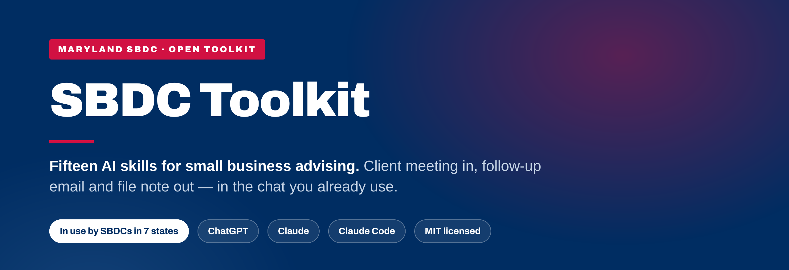
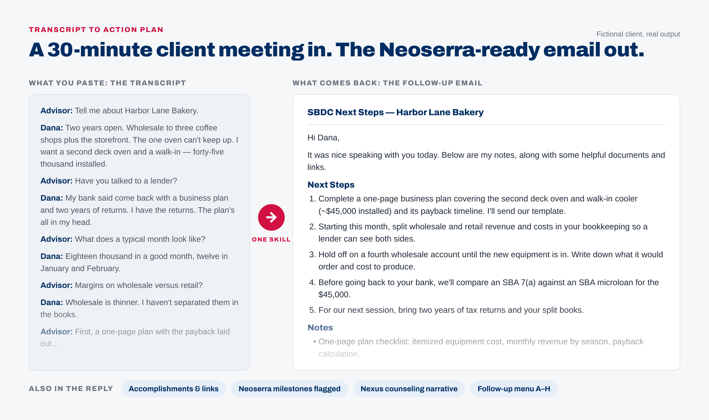
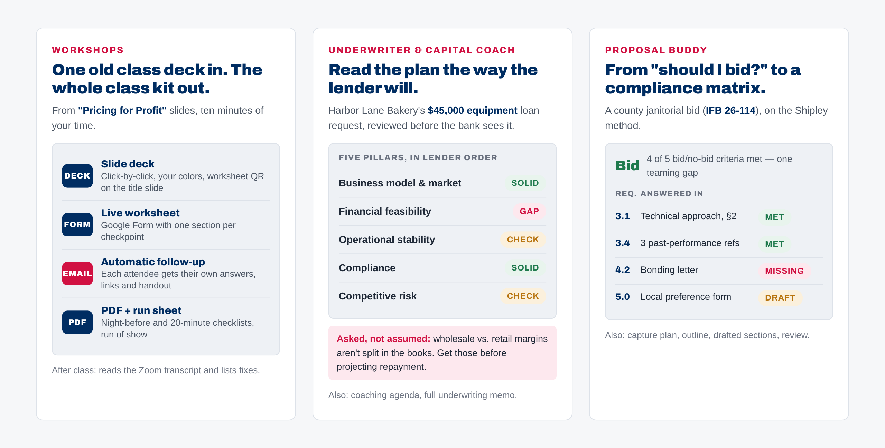

<p align="center">
  
</p>

<p align="center">
  <a href="https://bwfnx.github.io/sbdc-toolkit/"><strong>Guides</strong></a> &middot;
  <a href="#install"><strong>Install</strong></a> &middot;
  <a href="#the-15-skills"><strong>Skills</strong></a> &middot;
  <a href="https://bwfnx.github.io/sbdc-toolkit/resources.html"><strong>Resources</strong></a> &middot;
  <a href="https://github.com/bwfnx/sbdc-toolkit/releases/latest"><strong>Latest release</strong></a>
</p>

<p align="center">
  <a href="LICENSE"></a>
  <a href="https://github.com/bwfnx/sbdc-toolkit/releases/latest"></a>
  <a href="#the-15-skills"></a>
  
</p>

<br/>

<picture>
  <source media="(prefers-color-scheme: dark)" srcset="docs/img/hero-dark.png">
  
</picture>

# Turn a client meeting into the follow-up email and the file note — plus fourteen more advising jobs — in the chat you already use.

**A skill here is a plain Markdown file, not an app.** Each one is instructions your assistant reads and follows, so the same file works in ChatGPT, the Claude app, Claude Code, or anything else that accepts custom instructions. Nothing to host, nothing to pay for beyond the assistant you already have.

|        | Step                    | What happens                                                                 |
| ------ | ----------------------- | ---------------------------------------------------------------------------- |
| **01** | Meet with the client    | Record the session the way you already do — Zoom, Meet, Teams.                |
| **02** | Paste the transcript    | Say *"transcript to action plan"* and drop it in.                             |
| **03** | Post it to Neoserra     | Get back the client email, milestones flagged, and the counseling narrative.  |

<br/>

## This is for you if

- ✅ You're an **SBDC consultant** writing a follow-up email after every session
- ✅ Your center built **custom GPTs** and needs them moved before OpenAI retires GPTs on Enterprise workspaces on **December 11, 2026**
- ✅ You want **the same output** whether your center pays for ChatGPT or Claude
- ✅ You prep clients for **lenders, grants, or government bids** and want a second read before they walk in
- ✅ You run **workshops** and are tired of rebuilding the deck, worksheet, and follow-up by hand
- ✅ You're at a **VBOC, Women's Business Center, or other small business center** and can swap in your own CRM and programs

<br/>

## Three more worth a look

<picture>
  <source media="(prefers-color-scheme: dark)" srcset="docs/img/highlights-dark.png">
  
</picture>

<p align="center">
  <a href="https://bwfnx.github.io/sbdc-toolkit/sbdc-workshops.html">Workshops guide</a> &middot;
  <a href="https://bwfnx.github.io/sbdc-toolkit/sbdc-underwriter-and-capital-coach.html">Underwriter guide</a> &middot;
  <a href="https://bwfnx.github.io/sbdc-toolkit/proposal-buddy.html">Proposal Buddy guide</a>
</p>

<br/>

## The 15 skills

Every name links to its guide: what to have ready, what to say, what comes back, and what it will never do.

<table>
<tr><td colspan="3"><strong>Client meetings</strong></td></tr>
<tr>
<td width="33%" valign="top"><a href="https://bwfnx.github.io/sbdc-toolkit/transcript-to-action-plan.html"><strong>Transcript to Action Plan</strong></a> ⭐<br/><sub>Meeting transcript → the client email you post into Neoserra: Next Steps, Notes, Accomplishments, Links; milestones flagged.</sub></td>
<td width="33%" valign="top"><a href="https://bwfnx.github.io/sbdc-toolkit/transcript-to-meeting-notes.html"><strong>Transcript to Meeting Notes</strong></a><br/><sub>Your internal file record, four fixed sections every time.</sub></td>
<td width="33%" valign="top"><a href="https://bwfnx.github.io/sbdc-toolkit/transcript-to-sop.html"><strong>Transcript to SOP</strong></a><br/><sub>A process walkthrough → a procedure a new consultant could follow.</sub></td>
</tr>
<tr>
<td valign="top"><a href="https://bwfnx.github.io/sbdc-toolkit/client-follow-up-and-reengagement.html"><strong>Client Follow-up &amp; Re-engagement</strong></a><br/><sub>A warm email to a client who went quiet, from their record alone.</sub></td>
<td></td><td></td>
</tr>
<tr><td colspan="3"><strong>Capital and funding</strong></td></tr>
<tr>
<td valign="top"><a href="https://bwfnx.github.io/sbdc-toolkit/sbdc-underwriter-and-capital-coach.html"><strong>Underwriter &amp; Capital Coach</strong></a><br/><sub>Reads a plan like an SBA underwriter, then coaches the client on what a lender will flag.</sub></td>
<td valign="top"><a href="https://bwfnx.github.io/sbdc-toolkit/mdsbdc-debt-helper.html"><strong>Debt Helper</strong></a><br/><sub>Negotiating and restructuring debt a client already has.</sub></td>
<td valign="top"><a href="https://bwfnx.github.io/sbdc-toolkit/sbdc-grant-advisor.html"><strong>Grant Advisor</strong></a><br/><sub>Is this client grant-ready, which categories fit, and a verified table of live opportunities.</sub></td>
</tr>
<tr><td colspan="3"><strong>Planning and research</strong></td></tr>
<tr>
<td valign="top"><a href="https://bwfnx.github.io/sbdc-toolkit/business-model-canvas-helper.html"><strong>Business Model Canvas Helper</strong></a><br/><sub>Build a canvas block by block, or read a finished one for direction and KPIs.</sub></td>
<td valign="top"><a href="https://bwfnx.github.io/sbdc-toolkit/tam-sam-som.html"><strong>TAM / SAM / SOM</strong></a><br/><sub>Size a market in three defensible layers, math shown.</sub></td>
<td valign="top"><a href="https://bwfnx.github.io/sbdc-toolkit/sbdc-marketing-plan-generator.html"><strong>Marketing Plan Generator</strong></a><br/><sub>A strategic marketing plan from client inputs, a Vertical IQ report, and their website.</sub></td>
</tr>
<tr><td colspan="3"><strong>Contracts, referrals and stories</strong></td></tr>
<tr>
<td valign="top"><a href="https://bwfnx.github.io/sbdc-toolkit/proposal-buddy.html"><strong>Proposal Buddy</strong></a><br/><sub>Shipley-method government proposals: RFP analysis, bid/no-bid, capture, compliance matrix, writing, review.</sub></td>
<td valign="top"><a href="https://bwfnx.github.io/sbdc-toolkit/business-service-provider-referral-engine.html"><strong>Service Provider Referral Engine</strong></a><br/><sub>A neutral shortlist of attorneys, CPAs, insurers and more, with ready-to-send referral emails.</sub></td>
<td valign="top"><a href="https://bwfnx.github.io/sbdc-toolkit/sbdc-success-story.html"><strong>Success Story Writer</strong></a><br/><sub>A client win → success story, press release, blog, LinkedIn post, or legislative letter.</sub></td>
</tr>
<tr><td colspan="3"><strong>Training</strong></td></tr>
<tr>
<td valign="top"><a href="https://bwfnx.github.io/sbdc-toolkit/sbdc-workshops.html"><strong>Workshops</strong></a><br/><sub>An old class deck → slides, QR worksheet, automatic follow-up email, PDF, and run sheet.</sub></td>
<td valign="top"><a href="https://bwfnx.github.io/sbdc-toolkit/sbdc-training-newsletter.html"><strong>Training Newsletter</strong></a><br/><sub>Neoserra events export → course table → Constant Contact template.</sub></td>
<td></td>
</tr>
</table>

<br/>

## Install

Pick the assistant you already use. The outputs are the same.

<details>
<summary><strong>ChatGPT</strong> — Business and Enterprise workspaces</summary>
<br/>

Skills replace custom GPTs (OpenAI is retiring GPTs on Enterprise workspaces **December 11, 2026**). Two ways in:

1. **Install from GitHub** — switch the chat to **Work mode** (a regular chat can't install from GitHub), then paste:
   ```
   install https://github.com/bwfnx/sbdc-toolkit
   ```
2. **Upload the zip** — if your workspace blocks the GitHub install, download this repo as a ZIP (green **Code** button → Download ZIP) and upload it at [chatgpt.com/skills](https://chatgpt.com/skills).

Plugins/Skills rolled out on Business and Enterprise workspaces on 22 Sep 2026; they were not yet available on personal/Plus accounts at that time. On an account without them, open any `skills/<name>/SKILL.md`, copy the whole file, and paste it into a **Project**'s instructions or a custom GPT. One skill per Project.
</details>

<details>
<summary><strong>Claude app</strong> — desktop, no GitHub account needed</summary>
<br/>

Download `sbdc-toolkit.plugin` from the [latest release](https://github.com/bwfnx/sbdc-toolkit/releases/latest), drag it into a chat, and click **Accept**.
</details>

<details>
<summary><strong>Claude Code</strong></summary>
<br/>

```
/plugin marketplace add https://github.com/bwfnx/sbdc-toolkit.git
```
```
/plugin install sbdc-toolkit@maryland-sbdc
```

The repo is public, so no authentication is required.
</details>

<details>
<summary><strong>Anything else</strong></summary>
<br/>

Copy the skill text into whatever system prompt, project instruction, or agent config your assistant uses. Nothing in the files is vendor-specific.
</details>

**Updating:** Claude Code — `/plugin marketplace update maryland-sbdc`. Claude app — download the newer `.plugin` from the [latest release](https://github.com/bwfnx/sbdc-toolkit/releases/latest) and Accept again. ChatGPT — re-paste the changed skill file.

<br/>

## Adapting for your state

The skills encode Maryland practice. Swap the Maryland parts for your own and the rest works anywhere.

<details>
<summary><strong>What to swap, and where it appears</strong></summary>
<br/>

| Maryland-specific | Swap in | Where it appears |
|---|---|---|
| **Neoserra** CRM, its milestone list, and the Nexus / EDMIS counseling narrative | Your CRM's milestone categories and session-note rules | `transcript-to-action-plan-client-email` (milestone list, `references/milestone-mapping-reference.md`), `transcript-to-meeting-notes`, `transcript-to-sop`, `client-follow-up-and-reengagement`, `sbdc-success-story`, `sbdc-training-newsletter`, `business-service-provider-referral-engine` |
| **SDAT / Maryland Business Express** good-standing link | Your Secretary of State business entity search | `transcript-to-action-plan-client-email` |
| **Maryland Community Business Compass** funding search | Your state's program directory, or remove the line | `transcript-to-action-plan-client-email` |
| **Maryland MBE and MDOT** certifications | Your state's certification programs | `transcript-to-action-plan-client-email`, `transcript-to-meeting-notes`, `client-follow-up-and-reengagement` |
| **TEDCO, DHCD, Maryland Commerce** grant programs | Your state's economic development programs | `sbdc-grant-advisor`, `sbdc-success-story` |
| **Maryland SBDC deck design, logo, sign-up link, and county list** | Nothing to edit by hand: the first run asks for your name, colors, logo, sign-up link and service area, and saves them to `org.json` | `sbdc-workshops` (`org.example.json` is the Maryland version) |
| **"Maryland SBDC"** name, signature, and funding acknowledgment | Your center's name and required acknowledgment | `sbdc-grant-advisor`, `sbdc-success-story`, `sbdc-training-newsletter`, `business-service-provider-referral-engine`, `proposal-buddy` |

Ready to use as-is: `business-model-canvas-helper`, `mdsbdc-debt-helper`, `sbdc-underwriter-and-capital-coach`, `tam-sam-som`. `sbdc-marketing-plan-generator` has one Maryland mention.

Quick check after you adapt: search the `skills/` folder for "Maryland", "Neoserra", "SDAT", and "TEDCO". Anything left is something you haven't swapped yet.
</details>

<br/>

## FAQ

**Is this a custom GPT?**
No — it's what replaces one. Each skill is already in the SKILL.md shape OpenAI moved to, so you install the set instead of rebuilding fifteen GPTs by hand.

**Does client information leave my account?**
The skills run inside the assistant you already use. Nothing is sent anywhere else and nothing is stored by the skill. The chat itself is a record, so paste only what the deliverable needs.

**We're not an SBDC. Will it work?**
Yes. Swap the Maryland-specific parts above. The workshop skill asks for your organization's name, colors, and logo on first run.

**Who maintains it?**
Brandon Mason at the Maryland SBDC. If a skill does something odd, open an [issue](https://github.com/bwfnx/sbdc-toolkit/issues) with the skill name, what you said to start it, and a screenshot of the reply.

<br/>

## Notes

The guides in [`docs/`](docs/) are generated and published at <https://bwfnx.github.io/sbdc-toolkit/>. README images are rebuilt from `docs/img/src/` with `python3 docs/img/src/render.py`. The sample transcript and client are fictional.

This public toolkit intentionally excludes the internal `sbdc-second-brain` knowledge skill, which bundles private SBDC wiki material and is distributed separately.

## License

MIT — see [LICENSE](LICENSE). Archivo font in `docs/img/src/fonts/` is under the SIL Open Font License.

---

<p align="center">
  <sub>Built by the Maryland SBDC for every small business center. Take it, adapt it, tell us what broke.</sub>
</p>
